<div align="center">

# ASTRA · Astro Health Station

**A self-care health station for astronauts: check in, understand your body, and know what to do next, even when Earth is 20 minutes away.**

*NASA Space Apps Challenge project: a visual tool that helps astronauts assess their own health during space missions and gives guidance on treatment and health improvement.*

`Python` · `Flask` · `Socket.IO` · `SQLite` · `React 19` · `Three.js` · `ESP32 (CYD)` · `Raspberry Pi Pico + PN532 NFC` · `Groq AI (gpt-oss-120b)` · `Web Speech API`

> **Demo with placeholder data. Not medical advice.** Every health threshold and medical text is a clearly
> marked `PLACEHOLDER` in `config/*.json`, ready to be replaced with real flight-surgeon guidance.

<br>

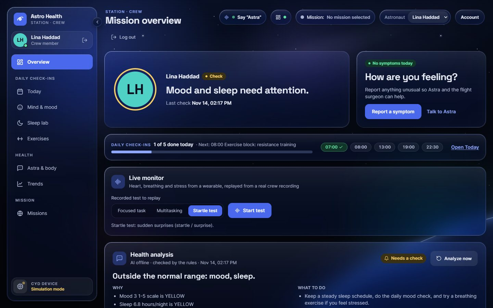

</div>

---

## Contents

1. [Screenshots](#1-screenshots)
2. [What exactly does it do?](#2-what-exactly-does-it-do)
3. [How does it work?](#3-how-does-it-work)
4. [What benefits does it have?](#4-what-benefits-does-it-have)
5. [What do we hope to achieve?](#5-what-do-we-hope-to-achieve)
6. [Tools, languages, hardware and software](#6-tools-languages-hardware-and-software)
7. [Use of AI (SI) tools](#7-use-of-ai-si-tools)
8. [NASA data](#8-nasa-data)
9. [Space agency partner data and other resources](#9-space-agency-partner-data-and-other-resources)
10. [Run it on Windows](#10-run-it-on-windows)
11. [Run it on Linux](#11-run-it-on-linux)
12. [Optional: AI, hardware and admin setup](#12-optional-ai-hardware-and-admin-setup)
13. [A 2-minute tour for judges](#13-a-2-minute-tour-for-judges)
14. [Testing](#14-testing)
15. [Project structure](#15-project-structure)
16. [Troubleshooting](#16-troubleshooting)

---

## 1. Screenshots

All screenshots use the built-in Simulator and invented demo crew and data (no hardware attached). The overview at the top shows a crew member's home screen with the AI health analysis.

<table>
<tr>
<td width="50%" valign="top">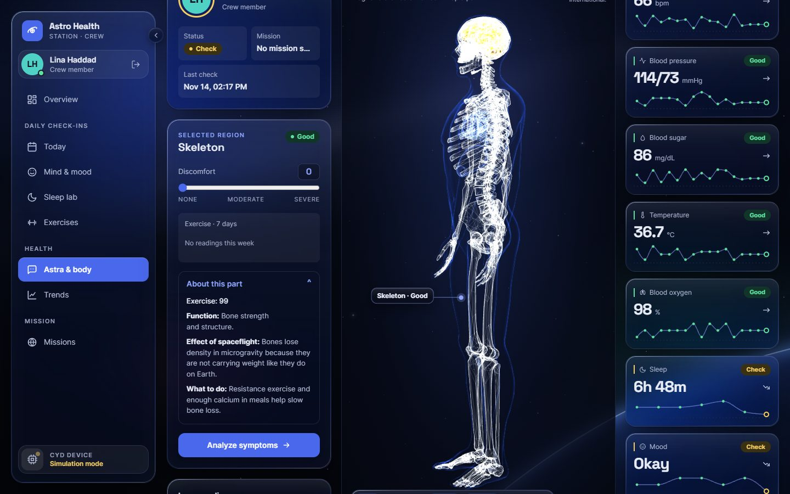<br><b>3D body twin · skeleton</b><br><sub>Real BodyParts3D anatomy. Tap a part (here the skeleton) to see its status, how space affects it and what to do.</sub></td>
<td width="50%" valign="top">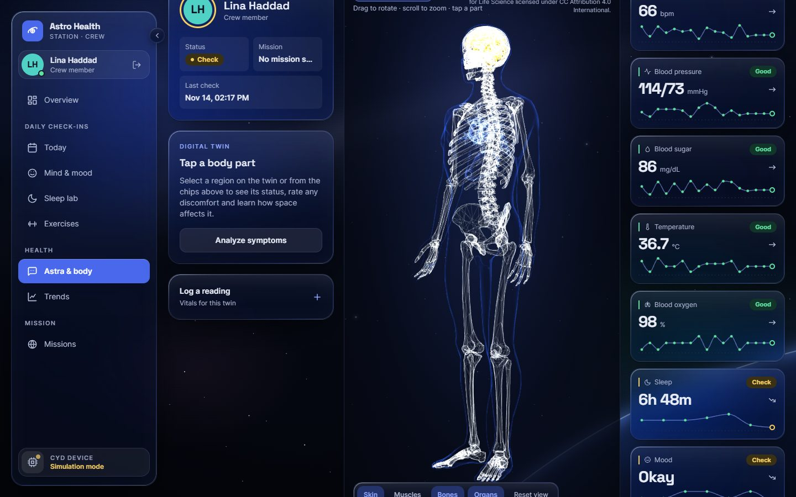<br><b>Astra & body</b><br><sub>The digital twin coloured by today's levels, next to every vital sign and its 7-day trend.</sub></td>
</tr>
<tr>
<td width="50%" valign="top">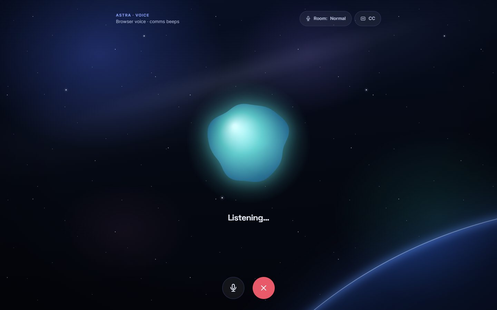<br><b>Astra, the voice assistant</b><br><sub>Say "Astra" on any page: a hands-free call that answers from your own data, logs things after a yes, and can call for help.</sub></td>
<td width="50%" valign="top">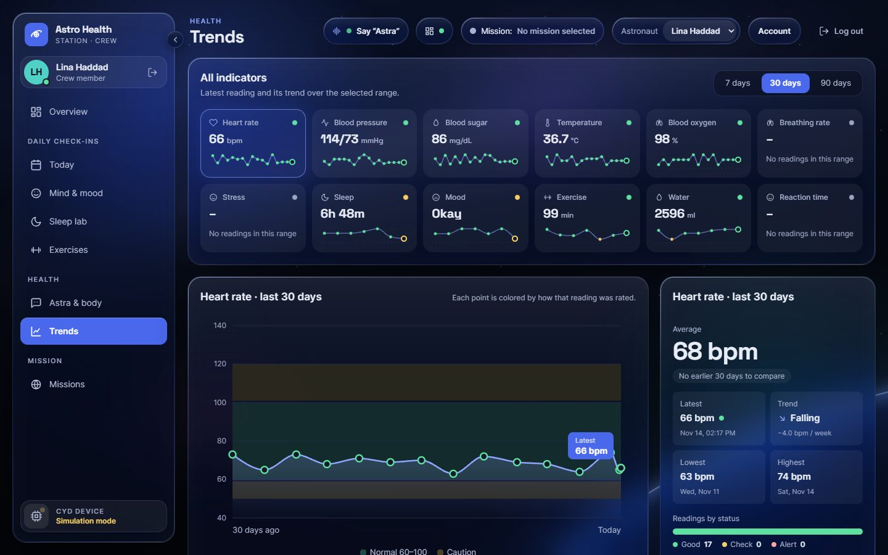<br><b>Trends</b><br><sub>Every indicator over 7, 30 or 90 days, coloured by the placeholder GREEN / YELLOW / RED bands.</sub></td>
</tr>
<tr>
<td width="50%" valign="top">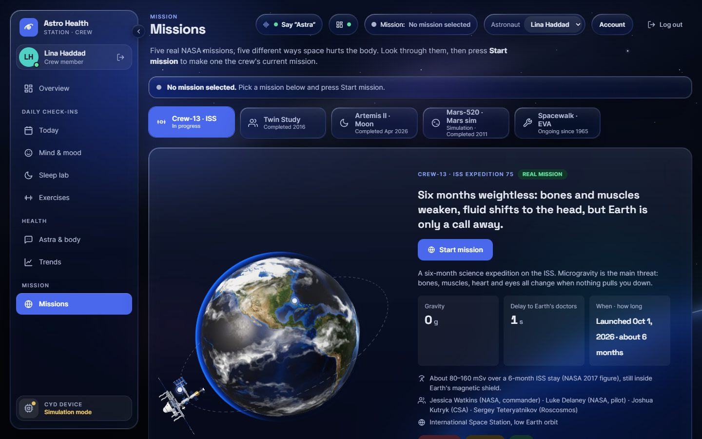<br><b>Mission health</b><br><sub>Five real NASA missions with 3D scenes (NASA 3D Resources), how each one stresses the body, and the sources behind it.</sub></td>
<td width="50%" valign="top">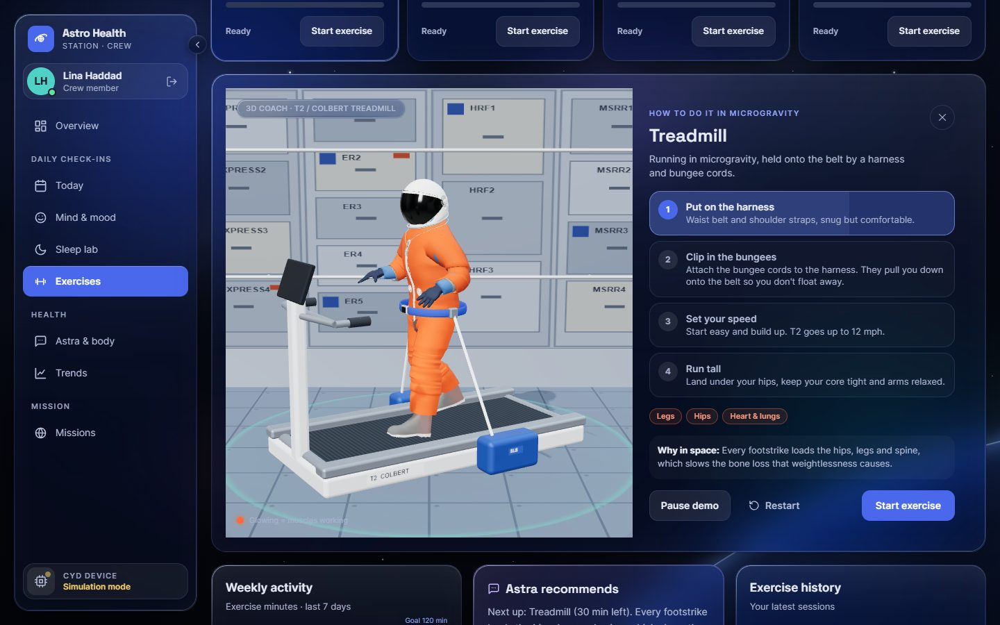<br><b>Exercises with a 3D coach</b><br><sub>ISS-style T2 treadmill, CEVIS cycle and ARED workouts, demonstrated step by step by an astronaut coach.</sub></td>
</tr>
<tr>
<td width="50%" valign="top">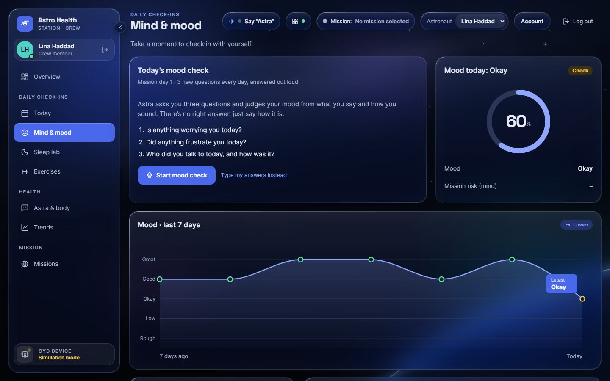<br><b>Mind & mood</b><br><sub>A daily AI mood check by voice, the mood trend, and optional on-device face, posture and voice-tone observations.</sub></td>
<td width="50%" valign="top">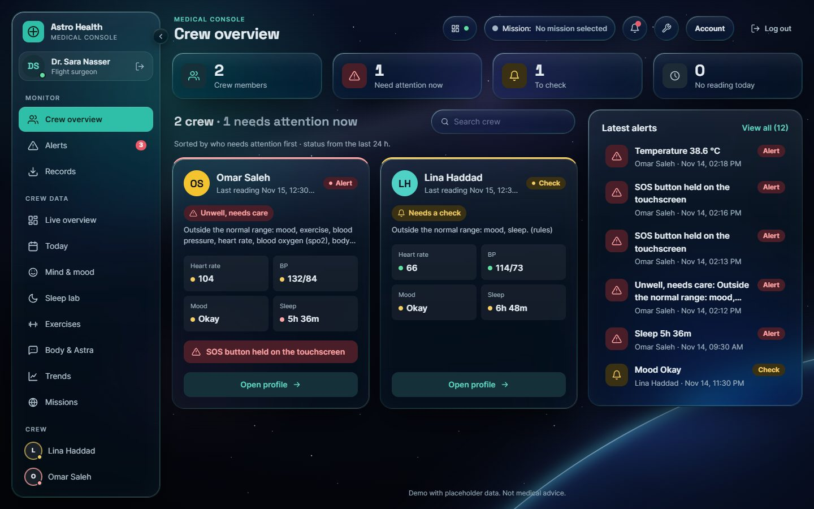<br><b>Flight surgeon console</b><br><sub>The whole crew sorted by who needs attention first, live alerts, and messages that respect the comms delay.</sub></td>
</tr>
<tr>
<td width="50%" valign="top">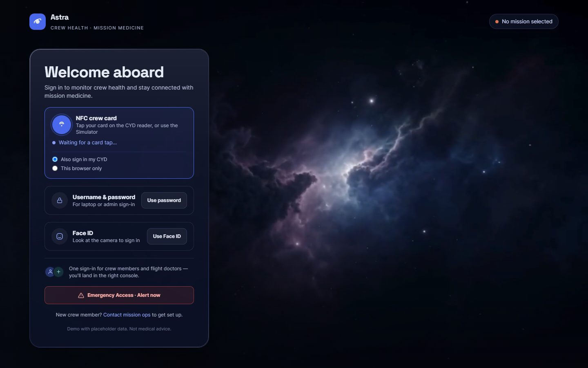<br><b>Sign in</b><br><sub>Tap an NFC crew card, or use a password or Face ID. Each astronaut only ever sees their own data.</sub></td>
<td width="50%" valign="top">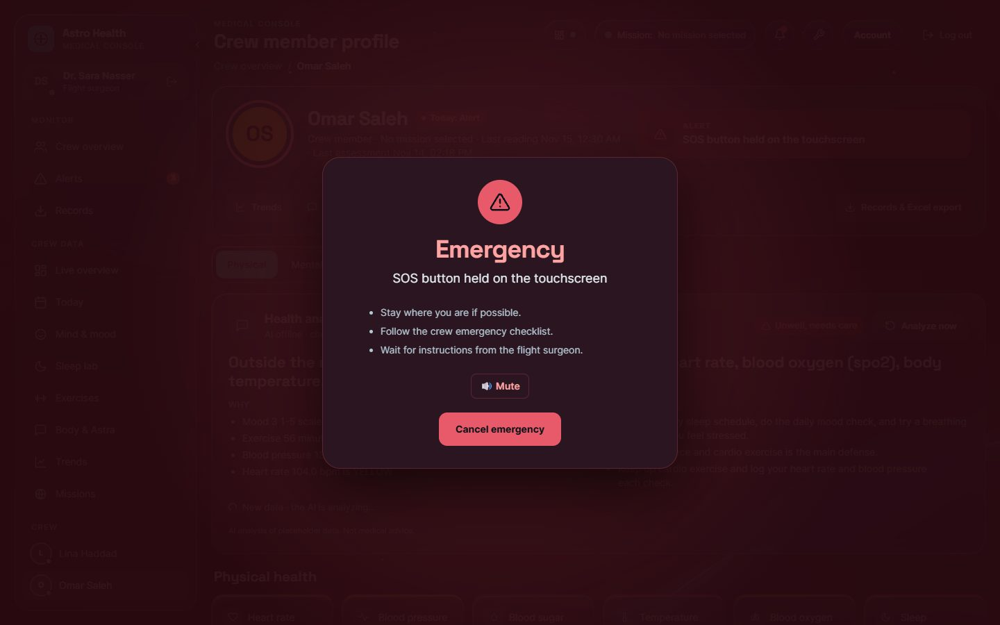<br><b>Emergency mode</b><br><sub>Raised from the device's SOS button, an emergency card, the web app or Astra; cancel with a button or by voice.</sub></td>
</tr>
</table>

---

## 2. What exactly does it do?

ASTRA turns a laptop, a pocket-sized touchscreen and an NFC reader into a **health station for a spacecraft, a space station, a rover or a Moon/Mars base**. Astronauts are not doctors, so every screen answers four questions in plain language: **How am I? Why does it matter in space? What should I do now? When should the flight surgeon be told?**

**For each crew member**

- **Sign in by tapping an NFC crew card** (or username/password, or Face ID). Each astronaut sees **only their own data**, enforced by the server, not just hidden in the UI.
- **Check in on the touchscreen device (CYD):** mood, a symptom checklist, a reaction-time test (a shortened version of a psychomotor vigilance test), guided box breathing, and an always-visible **SOS** button.
- **Vitals:** heart rate, blood pressure, blood sugar, body temperature, blood oxygen (SpO₂), sleep, mood, reaction time, exercise and water. Each one is colour-coded **GREEN / YELLOW / RED** with an icon and a word, never colour alone.
- **AI health analysis:** an AI looks at all of the astronaut's data together and decides what is going on (*doing well, sleeping, exercising, fatigued, stressed, possibly sick, unwell, emergency…*), explains why, says what to do, and alerts the flight surgeon when needed. If there is no internet, the station falls back to its own threshold rules, so it never stops working.
- **3D digital twin:** a realistic, clickable anatomy model (skeleton, muscles, organs) coloured by the astronaut's current levels. Tap a body part to learn what it does, how spaceflight affects it, and what to do.
- **Astra, the voice assistant:** say *"Astra"* on any page and talk hands-free, like a phone call. She answers from the astronaut's own data, can **open pages, log mood, sleep, symptoms, pain and vitals (always after a yes/no check), message the flight surgeon, run guided breathing and reaction tests, call for help ("emergency call now", "I need help": it starts the emergency at once, like the SOS button, even without saying "Astra") and cancel an emergency by voice**. She also speaks first: health warnings, schedule reminders, messages from Earth and a daily briefing. Ask her *"what do you think about our project?"* and she introduces herself and how she helps (about 12 seconds), or *"what can you do?"*. Both are answered instantly, even offline.
- **Live wearable monitor:** replays a **real NASA crew-state physiology recording** (heart rate from ECG, breathing rate, a relative stress level) as if from a wearable, with a moving ECG trace. One play-through becomes the day's vitals check.
- **Mind & mood:** a short **daily AI mood check** by voice or text, plus optional **on-device** wellbeing observations: **Face Analysis** (MediaPipe face landmarks, e.g. eye closure), **Pose Analysis** (posture) and **"Wanna talk?"** (voice-tone estimates from a local Wav2Vec2 model). All of it runs on the laptop; no video or audio leaves the station.
- **Spacewalk (EVA) mode:** switch an astronaut to "outside" and the live EVA is compared with **368 real spacewalks** from NASA's EVA log (typical length, the record), with real suit incidents from the log shown next to matching suit readings.
- **Trends, Sleep lab, Exercise (ISS-style T2 treadmill, CEVIS cycle, ARED resistance with a 3D coach), Schedule on a live mission clock, and Learn cards.**
- **Mission health:** pick one of five real missions (ISS Crew-13, the NASA Twins Study, Artemis II, Mars-520 and spacewalks/EVA) and see how each one stresses each body system, next to the astronaut's live levels, with a monitoring checklist and the NASA/ESA sources behind it.

**For the Flight Surgeon / Crew Medical Officer**

- A teal **medical console**: crew overview sorted by who needs attention first, an **alert inbox** with acknowledge, each astronaut's full profile, and **crew records** (filter every astronaut's daily data and export a formatted **Excel** file, or CSV).
- **Real communication delay:** messages between the crew and Earth wait for the mission's comms delay (from ~0 s in low Earth orbit up to ~20 min on a Mars transit), with a visible countdown. While Earth can't answer yet, the crew gets a self-care checklist.

**For everyone on board**

- **Emergency mode:** started from the device's SOS button, an emergency NFC card, the web app or Astra. Every screen shows a full-screen red alert with a checklist, the device flashes red and beeps, an alarm sounds on the flight surgeon's console, and a report goes to the flight surgeon. It can be cancelled with a button or by voice ("Astra, cancel the emergency" → "yes").
- A **crew-wide status board** for a shared station display, showing counts only and never names or individual readings.

---

## 3. How does it work?

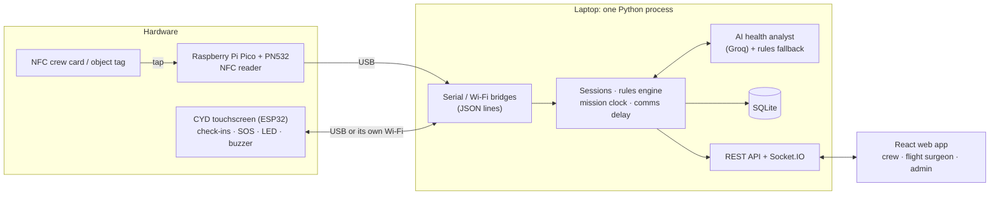

1. **Tap in.** The Pico reads the card's UID and sends `{"type":"scan","uid":"…"}` over USB. The laptop looks the UID up in its tag registry, opens that astronaut's session, signs in the browser and tells the CYD who is there. Unknown cards appear live on the `/admin` page to be assigned, so no firmware change is ever needed.
2. **Check in.** The CYD sends each result (mood, symptoms, reaction trials…) as one JSON line over USB serial, or over its own Wi-Fi access point when running from a power bank. It keeps working offline and queues results until the laptop is back.
3. **Assess.** Every new piece of data triggers the **AI health analyst** a few seconds later. It receives a compact summary (last 24 h of readings, 7-day statistics, symptoms, pain, open sleep/workout, mission and hazards, today's schedule) and must answer in strict JSON, which the server validates field by field. The verdict sets each reading's level, the overall state, the CYD screen and LED, and whether to alert the flight surgeon. With no key or no internet, `config/health_rules.json` decides instead.
4. **Push, never poll.** Every change goes out to every open screen instantly over Socket.IO: phones, laptops and the CYD.
5. **Earth is far away.** Reports and replies get a `deliver_at` time based on the mission's comms delay, sped up by a demo `TIME_SCALE` (1 real minute = 1 mission hour by default). They only appear once they "arrive".

**Key design rules**

- **The laptop is the source of truth.** Devices only send raw events and show what they are told.
- **Everything configurable lives in `config/*.json`** (thresholds, texts, missions, schedule, symptoms, the AI's instructions). Change it with no code change and no restart.
- **Graceful degradation everywhere:** no CYD → Simulator; no NFC reader → Simulator or password; no internet → rules engine and offline voice; no microphone → typing.
- **Safety first for anything that writes data:** Astra always asks *"Should I…?"* and saves nothing until the astronaut says yes. Emergencies count down so they can be cancelled.

---

## 4. What benefits does it have?

| Benefit | Why it matters in space |
|---|---|
| **Autonomy when Earth can't answer** | On a Mars transit a question to the ground takes up to ~40 minutes round trip. ASTRA gives immediate self-care guidance and escalates only what needs a doctor. |
| **Built for non-doctors** | Plain words, icons plus colour, a clickable body and a voice assistant mean anyone on the crew can use it under stress. |
| **Early warning from trends** | The AI and the rules engine look at combinations and trends (poor sleep + slower reaction time + low mood), not single numbers. |
| **Hands-free when hands are busy** | Voice check-ins, logging and SOS work while exercising, working or in a suit. |
| **Works offline** | No cloud is needed for the core: the rules engine, alerts, the device, the LED and the emergency path all keep working. |
| **Private by design** | Each astronaut sees only their own data. The shared status board shows only counts. |
| **Cheap, portable hardware** | A ~US$15 ESP32 touchscreen, a ~US$4 Pico and an NFC module. Any laptop runs the station. |
| **Ready for real data** | Every number is in config files, so real NASA thresholds and medical text can be swapped in without touching code. |

---

## 5. What do we hope to achieve?

- **Show that crew self-assessment can be simple, visual and trustworthy**: a tool an astronaut actually wants to use every day, not another form.
- **Prepare for Earth-independent medical operations** on long missions (Artemis, Mars), where the crew must handle first-line care themselves.
- **Keep the flight surgeon in the loop** with the right information at the right time, despite the communication delay.
- **Grow it into a real platform:** plug in real biomedical sensors (wearables, pulse oximeters), real NASA thresholds, and run the whole station on a Raspberry Pi on board.
- The same idea helps **people in remote and isolated places on Earth** too: Antarctic stations, ships, rural clinics and expeditions.

---

## 6. Tools, languages, hardware and software

| Area | What we used |
|---|---|
| **Languages** | Python, JavaScript (React/JSX), C++ (Arduino), HTML/CSS, JSON |
| **Backend** | Flask 3, Flask-SocketIO (threading mode), SQLite, pyserial, Werkzeug password hashing, NumPy, XlsxWriter (Excel export) |
| **On-device analysis (optional)** | MediaPipe Tasks (Face Landmarker, Pose Landmarker), OpenCV, PyTorch (CPU) + Hugging Face Transformers (Wav2Vec2 voice-tone model) |
| **Frontend** | React 19, Vite, React Router, TanStack Query, Tailwind CSS v4, Motion, d3 scales (hand-built SVG charts), Three.js + React Three Fiber/Drei (3D) |
| **AI and voice** | Groq API (`openai/gpt-oss-120b`, OpenAI-compatible) for health analysis and Astra's chat; browser Web Speech API for speech recognition and the offline voice; Microsoft Edge neural voices via `edge-tts`; Web Audio for station effects (Quindar tones, echo, radio) |
| **Face ID** | face-api.js (runs in the browser; the server makes the identity decision) |
| **Firmware** | Arduino C++ with TFT_eSPI, XPT2046_Touchscreen, ArduinoJson 7, Adafruit_PN532; `arduino-cli` |
| **Hardware** | CYD *Cheap Yellow Display* ESP32-2432S028R (2.8″ touchscreen, RGB LED, speaker), Raspberry Pi Pico (RP2040) + PN532 NFC module, NFC cards and tags, any laptop |
| **Testing** | pytest (360+ backend tests), Vitest (214 frontend tests), ESLint, headless Chromium end-to-end checks (Playwright) |
| **3D asset pipeline** | gltf-transform + meshoptimizer (anatomy model conversion) |

---

## 7. Use of AI (SI) tools

We used AI tools both **to build** the project and **inside** the product:

| Tool | Where and how |
|---|---|
| **Claude Code (Anthropic)** | Coding assistant during development: writing and refactoring backend, frontend and firmware code, tests, debugging, and documentation (including this README). Every change was reviewed and tested by the team. |
| **Groq-hosted `openai/gpt-oss-120b`** (with smaller Groq models as fallbacks) | **Inside the app at runtime:** the AI health analyst, Astra's conversation and the daily mood check. Its answers are validated by the server; the threshold rules take over when it isn't available. |
| **MediaPipe Face Landmarker and Pose Landmarker (Google, pre-trained)** | Optional on-device Face Analysis and Pose Analysis on the Mind page. |
| **Wav2Vec2 voice-emotion model** ([`Dpngtm/wav2vec2-emotion-recognition`](https://huggingface.co/Dpngtm/wav2vec2-emotion-recognition), Hugging Face) | Optional on-device voice-tone estimates in "Wanna talk?". The team's dataset research and CPU training study are in `data/training/reports/`. |
| **Microsoft Edge neural text-to-speech (`edge-tts`)** | Astra's optional neural voice, and the narration of our demo videos. |
| **Browser speech recognition (Web Speech API)** | Turns the astronaut's voice into text (Chrome/Edge). |
| **face-api.js (pre-trained face-recognition models)** | Optional Face ID sign-in. |

**No AI-generated content uses, contains or modifies NASA branding** (no NASA logos, flags or mission insignia were generated or edited). The NASA 3D models and images listed below are used unmodified, as published by NASA, apart from format conversion and cropping.

---

## 8. NASA data

| Resource | How we used it |
|---|---|
| [NASA Human Research Program: the five hazards of human spaceflight](https://www.nasa.gov/hrp/hazards) | The core model of the app: radiation, isolation and confinement, distance from Earth, gravity fields and hostile closed environments, mapped to each indicator and body system |
| [NASA: The Human Body in Space](https://www.nasa.gov/humans-in-space/the-human-body-in-space/) | Body-system effects shown on the 3D twin and in Learn |
| [NASA Twins Study results](https://www.nasa.gov/humans-in-space/nasas-twins-study-results-published-in-science-journal/) and the dataset on data.nasa.gov: [multi-omics analysis: mitochondrial stress in spaceflight](https://data.nasa.gov/dataset/comprehensive-multi-omics-analysis-reveals-mitochondrial-stress-as-a-central-biological-hu-79529) | "NASA Twin Study" mission profile in Mission health |
| [Artemis II mission](https://www.nasa.gov/mission/artemis-ii/) · [Artemis II crew as research subjects](https://www.nasa.gov/general/artemis-ii-crew-both-subjects-and-scientists-in-nasa-deep-space-research) | "Artemis II" mission profile |
| [NASA SpaceX Crew-13 to the ISS](https://www.nasa.gov/news-release/NASAs-spacex-crew-13-launches-to-international-space-station/) | "Crew-13 · ISS" mission profile |
| [Epigenetic patterns during the Mars 520-day mission simulation (data.nasa.gov)](https://data.nasa.gov/dataset/dynamic-nature-of-epigenetic-patterns-observed-during-the-mars-520-d-mission-simulation) | "Mars-520" mission profile |
| [Risk of injury from EVA](https://nasa.gov/reference/risk-of-injury-and-compromised-performance-from-extravehicular-activity-eva) · [EVA Injury Evidence Report 2021 (NTRS)](https://ntrs.nasa.gov/api/citations/20220004017/downloads/2021%20EVA%20Injury%20Evidence%20Report%20Final.docx.pdf) | "Spacewalks (EVA)" mission profile |
| [Extra-vehicular Activity (EVA) – US and Russia (data.nasa.gov)](https://data.nasa.gov/dataset/extra-vehicular-activity-eva-us-and-russia) | **Real spacewalk history** (`backend/eva/nasa_eva.csv`, 375 spacewalks 1965–2013): the live EVA is compared with 368 completed spacewalks, and real suit incidents are shown and given to the AI as context |
| NASA crew-state physiology dataset (ECG, respiration, skin conductance during attention and startle tests), as published for [Kaggle's "Reducing Commercial Aviation Fatalities"](https://www.kaggle.com/c/reducing-commercial-aviation-fatalities) | The **live wearable monitor**: one crew member's recording, reduced to per-second heart rate, breathing and relative stress (`backend/sensor/crew13.json`) |
| [NASA: Astronaut exercise (ARED, T2, CEVIS)](https://www.nasa.gov/missions/station/iss-research/astronaut-exercise) · [ISS exercise hardware overview (NTRS)](https://ntrs.nasa.gov/api/citations/20130009882/downloads/20130009882.pdf) | The Exercise page and its daily exercise goal |
| [NASA 3D Resources](https://github.com/nasa/NASA-3D-Resources): International Space Station, Extravehicular Mobility Unit, Habitat Demonstration Unit, Advanced Crew Escape Suit, Moon and Mars textures | 3D mission scenes and the exercise coach |
| [NASA Blue Marble Next Generation via NASA WorldWind](https://github.com/NASAWorldWind/WebWorldWind) | The Earth globe in the mission scenes |

---

## 9. Space agency partner data and other resources

**Space agency partners**

- **Canadian Space Agency (CSA):** [Artemis II science during the mission](https://www.asc-csa.gc.ca/eng/missions/artemis-ii/scientific-research-during-mission.asp) · [Physical activity in space](https://asc-csa.gc.ca/eng/astronauts/living-in-space/physical-activity-in-space.asp)
- **European Space Agency (ESA):** [Mars500 study overview](https://www.esa.int/Science_Exploration/Human_and_Robotic_Exploration/Mars500/Mars500_study_overview)

**Scientific references**

- Garrett-Bakelman et al., *The NASA Twins Study*, Science 2019: <https://www.science.org/doi/10.1126/science.aau8650>
- Basner et al., *Mars 520-d mission simulation reveals protracted crew hypokinesis and alterations of sleep duration and timing*, PNAS 2013: <https://pmc.ncbi.nlm.nih.gov/articles/PMC3574912>

**AI models and datasets (optional on-device analysis)**

- [MediaPipe Face Landmarker](https://ai.google.dev/edge/mediapipe/solutions/vision/face_landmarker) and Pose Landmarker (Google)
- [`Dpngtm/wav2vec2-emotion-recognition`](https://huggingface.co/Dpngtm/wav2vec2-emotion-recognition) (Hugging Face)
- [Open and Closed Eyes Dataset](https://huggingface.co/datasets/MichalMlodawski/closed-open-eyes) (ODC-BY), plus the speech datasets listed in [`data/training/reports/SUMMARY.md`](data/training/reports/SUMMARY.md): used for evaluation and training research

**3D models, images, sound and fonts**

- **BodyParts3D**, © The Database Center for Life Science, [CC BY 4.0](https://creativecommons.org/licenses/by/4.0/): the anatomy meshes of the digital twin (converted to `frontend/public/models/anatomy.glb`; attribution shown in the app)
- **X Bot** character from the [three.js examples](https://github.com/mrdoob/three.js) (Mixamo): motion source for the exercise coach (never shown on screen)
- Draco decoder shipped with three.js (MIT)
- Self-hosted fonts under the SIL Open Font License
- The emergency alarm sound and all icons and illustrations were made for this project

**Open-source software** (all used under their own licenses)

- Backend: [Flask](https://flask.palletsprojects.com/), [Flask-SocketIO](https://flask-socketio.readthedocs.io/), [simple-websocket](https://github.com/miguelgrinberg/simple-websocket), [pyserial](https://github.com/pyserial/pyserial), [pytest](https://pytest.org/), [edge-tts](https://github.com/rany2/edge-tts), [NumPy](https://numpy.org/), [XlsxWriter](https://github.com/jmcnamara/XlsxWriter), and optionally [MediaPipe](https://github.com/google-ai-edge/mediapipe), [OpenCV](https://opencv.org/), [PyTorch](https://pytorch.org/), [Transformers](https://github.com/huggingface/transformers)
- Frontend: [React](https://react.dev/), [Vite](https://vite.dev/), [Tailwind CSS](https://tailwindcss.com/), [three.js](https://threejs.org/), [React Three Fiber](https://github.com/pmndrs/react-three-fiber) / [Drei](https://github.com/pmndrs/drei), [TanStack Query](https://tanstack.com/query), [Motion](https://motion.dev/), [d3-scale](https://github.com/d3/d3-scale), [Socket.IO client](https://socket.io/), [face-api.js](https://github.com/justadudewhohacks/face-api.js), [gltf-transform](https://gltf-transform.dev/), [meshoptimizer](https://github.com/zeux/meshoptimizer)
- Firmware: [TFT_eSPI](https://github.com/Bodmer/TFT_eSPI), [XPT2046_Touchscreen](https://github.com/PaulStoffregen/XPT2046_Touchscreen), [ArduinoJson](https://arduinojson.org/), [Adafruit_PN532](https://github.com/adafruit/Adafruit-PN532), [arduino-pico core](https://github.com/earlephilhower/arduino-pico)
- Community hardware docs: [ESP32 Cheap Yellow Display](https://github.com/witnessmenow/ESP32-Cheap-Yellow-Display)
- AI service: [Groq](https://console.groq.com/) (free plan)

---

## 10. Run it on Windows

**You need:** Windows 10/11, **Python 3.10 or newer** ([python.org](https://www.python.org/downloads/); tick *"Add python.exe to PATH"* during setup), and **Chrome or Edge**. Git is optional. **Node.js is NOT needed**: the built web app (`frontend/dist`) is already in the repo.

Open **PowerShell** and run these one at a time:

```powershell
git clone https://github.com/3wrf/astra.git
```

```powershell
cd astra
```

(No Git? On the GitHub page click **Code → Download ZIP**, extract it, then `cd` into the extracted folder.)

```powershell
py -3 -m venv .venv
```

```powershell
.venv\Scripts\python.exe -m pip install -r requirements.txt
```

```powershell
.venv\Scripts\python.exe app.py --simulate
```

Open **<http://localhost:5000>** in Chrome or Edge. Use `localhost`, not an IP address: browsers only allow the microphone on `localhost` or https. Then follow the [2-minute tour](#13-a-2-minute-tour-for-judges).

> **Brave and Firefox:** the whole app works, but **talking to Astra by voice needs Chrome or Edge**. Brave switches off the browser's speech-recognition service and Firefox doesn't have one, so in those browsers you type to Astra instead (she still answers out loud).

- `py` not found? Use `python` instead of `py -3`.
- Stop the server with **Ctrl + C** in PowerShell.
- **With the real hardware plugged in**, run `.venv\Scripts\python.exe app.py` without `--simulate`. It finds the CYD and the Pico by itself. To force a port, use `--port COM5` (check *Device Manager → Ports (COM & LPT)*). The CYD needs the [CH340 USB driver](https://www.wch-ic.com/downloads/CH341SER_EXE.html) on Windows.

---

## 11. Run it on Linux

**You need:** Python 3.10+ with `venv`, and Chrome or Chromium (or Edge). Example for Debian/Ubuntu:

```bash
sudo apt install -y python3 python3-venv git
```

```bash
git clone https://github.com/3wrf/astra.git && cd astra
```

```bash
python3 -m venv .venv
```

```bash
.venv/bin/pip install -r requirements.txt
```

```bash
.venv/bin/python app.py --simulate
```

Open **<http://localhost:5000>**. Stop with **Ctrl + C**.

- **Real hardware:** run `.venv/bin/python app.py` (auto-detect) or `--port /dev/ttyUSB0`. Give your user access to serial ports once, then log out and back in:

  ```bash
  sudo usermod -aG dialout $USER
  ```

  (On Arch Linux the group is `uucp`.)
- Other distributions: install Python 3 and its `venv` module with your package manager (`dnf install python3`, `pacman -S python`); everything else is the same.

### Run options (both systems)

| Command | What it does |
|---|---|
| `app.py` | Auto-detect: CYD on USB → CYD's own Wi-Fi → Simulator |
| `app.py --simulate` | No hardware: the Simulator panel drives everything |
| `app.py --port COM5` / `--port /dev/ttyUSB0` | Force a serial port (or set `ASTRO_PORT`) |
| `app.py --wifi` | Use the CYD's own Wi-Fi network (`AstroHealthCYD`) |
| `app.py --web-port 8080` | Serve the web app on another port |
| `ASTRO_TIME_SCALE=60` | Mission clock speed (default: 1 real minute = 1 mission hour) |

---

## 12. Optional: AI, hardware and admin setup

### AI analysis and Astra (free, about 2 minutes)

Without a key everything still works, and the card reads *"AI offline · checked by the rules"*. To turn the AI on:

1. Create a free key at **[console.groq.com](https://console.groq.com/)** → *API Keys* (no credit card needed).
2. Save it in the project folder:
   - Windows (PowerShell): `Set-Content -NoNewline -Path data\ai_api_key -Value 'gsk_your_key_here'`
   - Linux: `printf '%s' 'gsk_your_key_here' > data/ai_api_key`

   (Or set the `AI_API_KEY` environment variable. Any OpenAI-compatible provider works with `AI_BASE_URL` and `AI_MODEL`.)
3. Restart `app.py`.

The AI's states and instructions are in `config/ai_analyst.json`. Astra's voice is chosen on `/admin` → *Station voice*.

### Optional on-device Face, Pose and voice-tone analysis (Mind page)

The app runs without these. They are big downloads, so they're kept in separate files:

| Feature | Install (Windows: `.venv\Scripts\python.exe`, Linux: `.venv/bin/python`) |
|---|---|
| Face and Pose Analysis (MediaPipe, ~100 MB) | `python -m pip install -r requirements-face.txt`, then follow [`docs/face-analysis-setup.md`](docs/face-analysis-setup.md) to download the models |
| "Wanna talk?" voice tone (PyTorch CPU + Wav2Vec2, ~1 GB with the model) | `python -m pip install -r requirements-emotion.txt`, then `python -m backend.services.emotion download` |

### Superuser admin page (assign NFC cards, manage crew accounts)

```powershell
.venv\Scripts\python.exe -m backend.auth.create_superuser
```

(Linux: `.venv/bin/python -m backend.auth.create_superuser`.) Then open <http://localhost:5000/admin>. Cards the reader doesn't know appear there live, ready to be assigned to a crew member or an object (treadmill, sleep station, food packet…).

### Hardware and firmware

| Part | Folder | Notes |
|---|---|---|
| CYD touchscreen (ESP32-2432S028R) | [`firmware/astro_cyd/`](firmware/astro_cyd/) | `arduino-cli compile --fqbn esp32:esp32:esp32:PartitionScheme=huge_app firmware/astro_cyd` |
| NFC reader (Raspberry Pi Pico + PN532) | [`firmware/pico_nfc_reader/`](firmware/pico_nfc_reader/) | Board `rp2040:rp2040:rpipico` (earlephilhower core); PN532 on GP1/GP2 |

Libraries, pins, wiring and upload steps are in [`firmware/README.md`](firmware/README.md). The CYD can also run from a power bank and connect over its own Wi-Fi.

### Replacing the placeholder data with real data

| File | Contents |
|---|---|
| `config/health_rules.json` | GREEN/YELLOW/RED ranges for every indicator |
| `config/content.json` | Plain-language text: body parts, hazards, measurement guides, Learn cards |
| `config/missions.json`, `config/mission_health.json` | Missions, comms delays, per-mission risks and monitoring plans |
| `config/routine.json` | The daily schedule |
| `config/symptoms.json` | Symptoms and their self-care guidance |
| `config/exercises.json` | Exercise devices and the daily goal |

---

## 13. A 2-minute tour for judges

Everything below works in `--simulate` mode with no hardware.

1. Open <http://localhost:5000> and **click once anywhere** (browsers only allow sound after a click).
2. Open the **Simulator** (bottom-right) and tap a **crew card**. You're signed in to that astronaut's **Overview**.
3. **Take a new reading → Assess.** A few seconds later the **AI health analysis** card updates (or *"checked by the rules"* without a key).
4. **Astra & body:** rotate the 3D twin and tap a body part. Then click **Talk to Astra** and say *"What do you think about our project?"* (a 12-second introduction), *"How am I doing?"*, or *"my back hurts, about a 6"* (she asks before saving), or *"take me to the sleep page"*.
5. Top bar → **Mission** → **Mars transit**, then send a message to the flight surgeon and watch the comms-delay countdown.
6. **Log out**, then tap the **Flight surgeon** card in the Simulator. Check **Crew overview** and **Alerts** (acknowledge one), then reply to the crew member.
7. Simulator → **Emergency card**: every screen turns red. Cancel it with the button, or sign in as crew and say *"Astra, cancel the emergency"* → *"yes"*.

The full feature guide is in [`docs/USER-GUIDE.md`](docs/USER-GUIDE.md).

---

## 14. Testing

```bash
.venv/bin/python -m pytest        # Windows: .venv\Scripts\python.exe -m pytest
```

360+ backend tests: rules engine, serial protocol, sessions, REST API, access control, AI output validation, scheduler, bridges, sensor feed, EVA history, Excel export.

Frontend (needs Node.js 20.19+ or 22+):

```bash
cd frontend
npm install
npm test          # 214 Vitest tests
npm run dev       # http://localhost:5173 with hot reload (the backend must run on :5000)
npm run build     # rebuild frontend/dist after changing the UI
```

---

## 15. Project structure

```text
astra/
├── app.py                  entry point: Flask + Socket.IO, picks a hardware bridge, serves the web app
├── requirements.txt
├── backend/
│   ├── routes/             REST API (/api/*) and the admin API
│   ├── auth/               crew / flight surgeon login, superuser accounts
│   ├── hardware/           serial protocol + USB, Wi-Fi and Pico bridges
│   ├── logic/              sessions, rules engine, AI analysis pipeline, symptoms, Astra's memory
│   ├── services/           AI analyst (Groq) and neural voice
│   └── jobs/               mission clock, reminders, comms-delayed messages
├── config/                 every PLACEHOLDER value: thresholds, texts, missions, schedule, AI instructions
├── frontend/               React app (src/) and its committed build (dist/)
├── firmware/
│   ├── astro_cyd/          CYD touchscreen sketch
│   └── pico_nfc_reader/    Pico + PN532 NFC reader sketch
├── tests/                  pytest suite
├── docs/                   screenshots/, videos, PDFs, user guide, original build spec, developer notes
└── data/                   created on first run (database, secret key): not in git
```

---

## 16. Troubleshooting

| Problem | Fix |
|---|---|
| *"Frontend not built yet"* | `cd frontend && npm install && npm run build` |
| Astra doesn't hear you | Use Chrome or Edge (voice input doesn't work in Brave or Firefox), open `http://localhost:5000` (not an IP address), allow the microphone, and click the page once. Mute the emergency alarm if it's sounding. |
| *"AI offline · checked by the rules"* | No key, no internet, or the free limit was reached. Everything else keeps working. |
| *"Could not open port"* | Close the Arduino Serial Monitor or anything else using the port; the app retries every 3 s. |
| Windows doesn't see the CYD | Install the CH340 driver and use `--port COMx`. |
| Linux "permission denied" on `/dev/ttyUSB0` | `sudo usermod -aG dialout $USER`, then log out and back in. |
| 3D views say WebGL is unavailable | Turn on hardware acceleration in the browser settings, then reload. |
| Nothing on a phone | Use this computer's LAN IP on the same network (voice needs `localhost` or https). |

---

<div align="center">

Built for the **NASA Space Apps Challenge**. All crew data is invented. **Not medical advice.**

</div>
